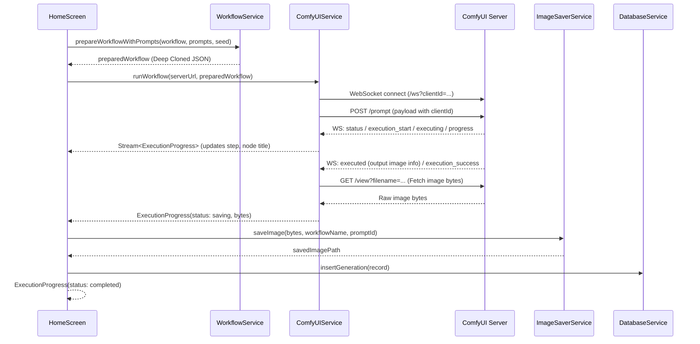

# AGENTS.md — Agent & Developer Guide for ComfyUI Runner

This document provides architecture blueprints, execution flows, conventions, and operational instructions for AI coding agents and human developers maintaining or extending the **ComfyUI Runner** codebase.

---

## 1. Project Overview & Capabilities

**ComfyUI Runner** (`comfyui_app`) is a cross-platform Flutter application (Android, iOS, Linux, macOS, Windows, Web) designed to execute, monitor, and manage [ComfyUI](https://github.com/comfyanonymous/ComfyUI) workflows directly from desktop and mobile devices.

### Key Capabilities
- **Direct ComfyUI Server Integration**: Communicates with ComfyUI over HTTP REST (`/prompt`, `/history`, `/view`, `/system_stats`) and WebSocket (`/ws?clientId=...`).
- **Real-Time Step Monitoring**: Streams node execution states, sampling steps, and progress percentages via WebSocket.
- **Bundled & Custom Workflows**: Discovers API JSON workflows in `workflows/`, categorized and selectable via a filterable bottom sheet.
- **Intelligent Prompt & Seed Manipulation**: Automatically identifies positive/negative prompt nodes (supporting SD1.5, SDXL `text_g`/`text_l`, Flux, AnimateDiff) and randomizes seeds (`seed`, `noise_seed`, `PrimitiveInt`).
- **Dual-Track History**:
  - **Local SQLite History**: Persistent records of prompt inputs, timestamps, seed values, and saved file paths with an automated in-memory fallback.
  - **Server Remote History**: Live browser for past runs on ComfyUI (`/history`), supporting keyword search, direct Prompt ID lookup, prompt reloading, and image batch download.
- **Cross-Platform Image Export**: Saves outputs locally in app storage and synchronizes with native device photo galleries (`gal` on Android/iOS, `~/Pictures/ComfyUI` on Desktop).

---

## 2. Environment & CLI Commands

The development environment utilizes Flutter and Dart (managed via `mise` or system PATH).

### Toolchain Paths & Setup
- **Dart Version**: `>= 3.13.5`
- **Flutter Version**: `3.47.7` (Stable)
- **Primary Binary**: `flutter` (or `~/.local/share/mise/installs/flutter/3.47.7-stable/bin/flutter`)

### Essential Commands
Run these commands from the project root (`/home/kiddos/projects/comfyui_app`):

```bash
# Get dependencies
flutter pub get

# Run static analysis and linting (must pass with 0 issues)
flutter analyze

# Run unit and widget test suite
flutter test

# Run tests with verbose output
flutter test --reporter expanded

# Run the app on available device / desktop
flutter run -d linux   # or macos, windows, chrome, android, ios
```

> **Note for AI Agents**: In sandbox environments where home-directory toolchains are isolated, run shell commands with the appropriate permissions if `flutter` binary resolution requires host access.

---

## 3. Architecture & Codebase Map

```text
comfyui_app/
├── lib/
│   ├── main.dart                       # Entry point, theme definitions (Material 3 light/dark)
│   ├── models/
│   │   ├── execution_state.dart        # ExecutionStatus enum and ExecutionProgress state
│   │   ├── comfyui_history_item.dart   # Server history & ComfyUIImageInfo parser
│   │   └── generation_record.dart      # Local history database model
│   ├── services/
│   │   ├── comfyui_service.dart        # HTTP client, WebSocket stream & server history API
│   │   ├── database_service.dart       # SQLite FFI manager with in-memory fallback
│   │   ├── image_saver_service.dart    # Device gallery and filesystem export handler
│   │   └── workflow_service.dart       # JSON asset loader, prompt extractor, seed injector
│   ├── screens/
│   │   ├── home_screen.dart            # Main generation dashboard (picker, prompts, run, preview)
│   │   ├── history_screen.dart         # Dual-tab history screen (Saved Local vs Server History)
│   │   └── server_history_screen.dart  # Dedicated server history browser page
│   └── widgets/
│       ├── connection_card.dart        # Server URL input, status indicator, and ping probe
│       ├── progress_monitor.dart       # Progress bar, current step, and cancel action
│       ├── prompt_editor.dart          # Cards for positive/negative prompts & seed toggle
│       ├── result_view.dart            # Pinch-to-zoom image viewer & gallery save actions
│       ├── server_history_view.dart    # Searchable list of remote runs with download & reuse
│       └── workflow_picker.dart        # Categorized bottom-sheet selector with search
├── workflows/                          # Bundled ComfyUI workflow JSON files (API format)
└── test/
    ├── history_feature_test.dart       # Unit & widget tests for server history parsing & UI
    └── widget_test.dart                # Tests for workflow parsing, DB fallback, & widget UI
```

---

## 4. Component Details & Data Flow

### 4.1 Execution Data Flow



### 4.2 Key Service Responsibilities

#### `ComfyUIService` (`lib/services/comfyui_service.dart`)
- **Singleton**: Access via `ComfyUIService.instance`.
- **`normalizeUrl(String input)`**: Cleans whitespace, prefixes missing `http://`, strips trailing slashes, and defaults to `http://192.168.0.100:8188`.
- **`testConnection(String serverUrl)`**: Checks `/system_stats` then falls back to `/prompt` with a 4s timeout.
- **`runWorkflow(...)`**: Returns a `Stream<ExecutionProgress>`. Handles WebSocket connection, listener lifecycle, cancellation, error messages, and automatic result download.
- **`fetchHistory(...)` & `fetchPromptHistory(...)`**: Reads from `/history` or `/history/{promptId}` and converts raw JSON into sorted `List<ComfyUIHistoryItem>`.
- **`downloadAndSaveImage(...)`**: Downloads remote image bytes, invokes `ImageSaverService`, and persists a record in `DatabaseService`.

#### `WorkflowService` (`lib/services/workflow_service.dart`)
- **`getAvailableWorkflows()`**: Dynamically discovers `.json` files in `workflows/` via `AssetManifest` with a fallback list of bundled workflows.
- **`extractPrompts(Map<String, dynamic> workflow)`**: Inspects nodes for titles matching `positive_prompt` or `negative_prompt`, extracting values from `inputs['text']`, `inputs['text_g']`, or `inputs['text_l']`.
- **`prepareWorkflowWithPrompts(...)`**: Creates a deep clone (`jsonDecode(jsonEncode(...))`) and applies prompt changes and random seed values (`seed`, `noise_seed`, and `PrimitiveInt` values).

#### `DatabaseService` (`lib/services/database_service.dart`)
- **Singleton**: Access via `DatabaseService.instance`.
- **Tables**: `settings` (key/value, stores `server_url`) and `generations` (id, workflow_name, prompts, prompt_id, image_path, server_url, created_at).
- **FFI & Resilience**: Desktop platforms initialize `sqfliteFfiInit()`. If native SQLite library fails to load (e.g. GLIBC version mismatch), it automatically falls back to `_useMemoryFallback` without throwing unhandled exceptions.

#### `ImageSaverService` (`lib/services/image_saver_service.dart`)
- Writes output PNG to local app documents directory (`comfyui_images/`).
- On **Android & iOS**: Checks/requests permission and saves to `'ComfyUI'` device album via `Gal.putImage`.
- On **Desktop (Linux/macOS/Windows)**: Copies image to user's `~/Pictures/ComfyUI` or `%USERPROFILE%/Pictures/ComfyUI`.

---

## 5. Development Conventions & Guidelines

### 5.1 Code Style & Linting
- **Ruleset**: Configured via `analysis_options.yaml` (`package:flutter_lints/flutter.yaml`).
- **Null Safety**: 100% sound null safety. Avoid force-unwrapping (`!`) unless safety has been explicitly checked or guaranteed.
- **Const Constructors**: Use `const` wherever possible for widget and model constructors to optimize widget rebuilds.
- **No Direct Mutation**: Workflows and state maps must be cloned before modification.

### 5.2 Theming & Responsive UI
- **Material 3**: App supports both system light and dark themes.
- **Color Discipline**:
  - Never hardcode `Colors.black` or `Colors.white` for labels or card backgrounds.
  - Use `Theme.of(context).colorScheme.onSurface`, `surfaceVariant`, `outline`, etc.
  - Follow the existing card pattern: `CardThemeData` with 0 elevation and subtle border.

### 5.3 Error Handling & Fallbacks
- Network, WebSocket, and SQLite operations must always be guarded with `try-catch` blocks.
- When native platform plugins fail (e.g. `gal` permissions denied, SQLite FFI dynamic link issues), fall back gracefully and log via `debugPrint`.

---

## 6. Testing Strategy

All new features and fixes must include corresponding tests in `test/`.

### Existing Test Suites
1. **`test/widget_test.dart`**:
   - `WorkflowService`: Tests prompt extraction (`text`, `text_g`, `text_l`) and seed randomization.
   - `DatabaseService`: Tests default URL retrieval, updating server URL, and generation CRUD (validates memory fallback when FFI fails).
   - `PromptEditor`: Tests text editing controllers and user interaction.
   - `WorkflowPicker`: Tests dark/light mode text contrast and category filters.
2. **`test/history_feature_test.dart`**:
   - `ComfyUIHistoryItem`: Validates parsing of standard ComfyUI `/history` output, KSampler linked node resolution, and `/view` URI construction.
   - `ServerHistoryView`: Tests widget rendering, lookup dialog, and search filters.

### Running & Verifying Tests
```bash
# Run all tests
flutter test

# Verify code formatting & linting
flutter analyze
```

---

## 7. Working with ComfyUI Workflows

When adding new ComfyUI workflows into `workflows/`:
1. Ensure the JSON is exported in **API format** from ComfyUI (requires ComfyUI Dev Mode enabled in settings).
2. Ensure prompt nodes have recognizable titles:
   - Positive prompt: Node title set to `positive_prompt`
   - Negative prompt: Node title set to `negative_prompt`
3. If prompt nodes are not explicitly titled, the app will attempt KSampler link tracing, but explicit titles are strongly recommended.
4. Add the file to `workflows/<name>.json`. Asset bundling in `pubspec.yaml` maps the entire directory (`workflows/`).
5. Update `WorkflowService.bundledWorkflows` list if the asset manifest is ever unavailable.
