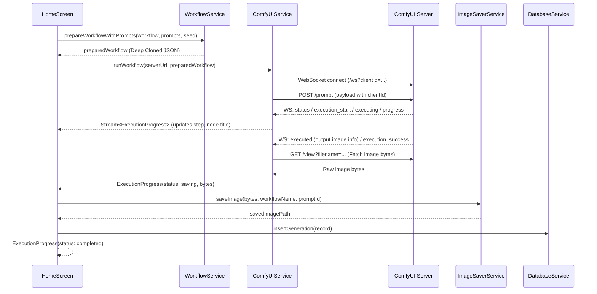

# AGENTS.md — Agent & Developer Guide for ComfyUI Runner

This document provides architecture blueprints, execution flows, conventions, and operational instructions for AI coding agents and human developers maintaining or extending the **ComfyUI Runner** codebase.

---

## 1. Project Overview & Architecture

**ComfyUI Runner** (`comfyui_app`) is a cross-platform Flutter application (Android, iOS, Linux, macOS, Windows, Web) designed to execute, monitor, and manage ComfyUI workflows directly from desktop and mobile devices.

### Architecture
- **Layer-First Structure**: The `lib/` directory is organized by technical concern (`models/`, `screens/`, `services/`, `widgets/`, `main.dart`).
- **State Management**: Relies heavily on Flutter's built-in `setState` within `StatefulWidget`s. No external state management libraries (like Provider, Riverpod, Bloc, or Signals) are used.
- **Dependency Injection**: Uses Singleton instances for services, specifically `DatabaseService.instance` and `ComfyUIService.instance`.
- **Routing**: Uses standard Flutter `Navigator` (`Navigator.push`, `Navigator.pop`). No advanced routing packages (like GoRouter or AutoRoute) are used.

### Directory Map
```text
comfyui_app/
├── lib/
│   ├── main.dart                       # Entry point, theme definitions (Material 3 light/dark)
│   ├── models/
│   │   ├── execution_state.dart        # ExecutionStatus enum and ExecutionProgress state
│   │   ├── comfyui_history_item.dart   # Server history & ComfyUIImageInfo parser
│   │   └── generation_record.dart      # Local history database model
│   ├── services/
│   │   ├── comfyui_service.dart        # HTTP client, WebSocket stream & server history API
│   │   ├── database_service.dart       # SQLite FFI manager with in-memory fallback
│   │   ├── image_saver_service.dart    # Device gallery and filesystem export handler
│   │   └── workflow_service.dart       # JSON asset loader, prompt extractor, seed injector
│   ├── screens/
│   │   ├── home_screen.dart            # Main generation dashboard (picker, prompts, run, preview)
│   │   ├── history_screen.dart         # Dual-tab history screen (Saved Local vs Server History)
│   │   └── server_history_screen.dart  # Dedicated server history browser page
│   └── widgets/
│       ├── connection_card.dart        # Server URL input, status indicator, and ping probe
│       ├── progress_monitor.dart       # Progress bar, current step, and cancel action
│       ├── prompt_editor.dart          # Cards for positive/negative prompts & seed toggle
│       ├── result_view.dart            # Pinch-to-zoom image viewer & gallery save actions
│       ├── server_history_view.dart    # Searchable list of remote runs with download & reuse
│       └── workflow_picker.dart        # Categorized bottom-sheet selector with search
├── workflows/                          # Bundled ComfyUI workflow JSON files (API format)
└── test/
    ├── history_feature_test.dart       # Unit & widget tests for server history parsing & UI
    └── widget_test.dart                # Tests for workflow parsing, DB fallback, & widget UI
```

### Component Details & Data Flow
Data generally flows from UI (`HomeScreen`) -> Services (`WorkflowService`, `ComfyUIService`) -> ComfyUI Server -> UI -> Local DB (`DatabaseService`).



**Key Service Responsibilities:**
- **`ComfyUIService`**: Manages HTTP clients, WebSocket streams (`normalizeUrl`, `testConnection`, `runWorkflow`, `fetchHistory`).
- **`WorkflowService`**: Handles JSON asset loading, prompt extraction, and seed injection (`getAvailableWorkflows`, `extractPrompts`, `prepareWorkflowWithPrompts`).
- **`DatabaseService`**: SQLite database with in-memory fallback for persistent local history tracking.
- **`ImageSaverService`**: Writes output PNGs to local storage and syncs with native galleries.

---

## 2. Environment, Code Generation & Build Commands

- **Flutter/Dart SDK**: Requires Dart SDK `>= 3.13.5` and Flutter Version `3.47.7` (Stable).
  > **Note for AI Agents**: In sandbox environments where home-directory toolchains are isolated, run shell commands with the appropriate permissions if `flutter` binary resolution requires host access.
- **Dependencies Management**: Fetch dependencies using:
  ```bash
  flutter pub get
  ```
- **Code Generation**: This project does **not** use code generation tools like `build_runner`, `freezed`, or `json_serializable`.
- **Localization**: No special localization config (`l10n.yaml`) is present.
- **Build Commands**:
  - For Android APK (debug): `flutter build apk --debug`
  - For Linux Desktop: `flutter build linux`
  - For Windows Desktop: `flutter build windows`
  - For macOS Desktop: `flutter build macos`

---

## 3. Testing, Static Analysis & Verification Workflow

- **Static Analysis**: The project uses `flutter_lints`. To check for errors, warnings, and lints (must pass with 0 issues):
  ```bash
  flutter analyze
  ```
- **Formatting**: To format all Dart code:
  ```bash
  dart format --output=none --set-exit-if-changed .
  ```
- **Testing**:
  - To run all unit and widget tests:
    ```bash
    flutter test
    ```
  - To target a single test file (e.g., `widget_test.dart`):
    ```bash
    flutter test test/widget_test.dart
    ```
  - **Note**: Only headless unit/widget tests are present. No device-dependent `integration_test/` directory exists.

**Existing Test Suites**:
1. `test/widget_test.dart`: Tests for `WorkflowService` (prompt extraction, seed randomization), `DatabaseService`, `PromptEditor`, and `WorkflowPicker`.
2. `test/history_feature_test.dart`: Tests for `ComfyUIHistoryItem` (JSON parsing) and `ServerHistoryView`.

---

## 4. Dart & Flutter Coding Conventions

- **Widget & UI Layer**:
  - Prefer creating small `StatelessWidget` or `StatefulWidget` classes over using helper methods that return widgets.
  - Utilize `const` constructors wherever possible for widgets and models to optimize rebuilds.
  - **Material 3 / Color Discipline**: Use `Theme.of(context)` for styling (e.g., `Theme.of(context).colorScheme.onSurface`). Do not hardcode colors like `Colors.black` or `Colors.white`. Follow the existing card pattern: `CardThemeData` with 0 elevation and subtle border.
- **No Direct Mutation**: Workflows and state maps must be cloned before modification.
- **State & Concurrency**:
  - Follow patterns for reactive state and ensure to check `if (!context.mounted) return;` across `async` gaps before interacting with `context`.
  - Network, WebSocket, and SQLite operations must always be guarded with `try-catch` blocks.
- **Native Interop**: No custom platform channels (`MethodChannel`/`EventChannel`), Pigeon schemas, or Dart FFI bindings are present natively in this repo; it relies on established plugins (e.g., `gal`, `sqflite_common_ffi`). Fall back gracefully when native platform plugins fail and log via `debugPrint`.

---

## 5. Agent Guardrails (Do's and Don'ts)

- **Do** always re-run `flutter analyze` and `flutter test` before finalizing and committing changes.
- **Do** use `flutter pub add <package>` or `flutter pub remove <package>` to manage packages in `pubspec.yaml`.
- **Don't** manually edit generated files, although this project currently does not have any generated files (`*.g.dart`, `*.freezed.dart`, etc.).
- **Don't** force-unwrap null values (`!`) unless safety has been explicitly checked or guaranteed.

### Working with ComfyUI Workflows
When adding new ComfyUI workflows into `workflows/`:
- **Do** ensure the JSON is exported in **API format** from ComfyUI (requires ComfyUI Dev Mode enabled in settings).
- **Do** ensure prompt nodes have recognizable titles:
  - Positive prompt: Node title set to `positive_prompt`
  - Negative prompt: Node title set to `negative_prompt`
- **Don't** forget to add the file to `workflows/<name>.json`. If prompt nodes are not explicitly titled, the app will attempt KSampler link tracing, but explicit titles are strongly recommended.
