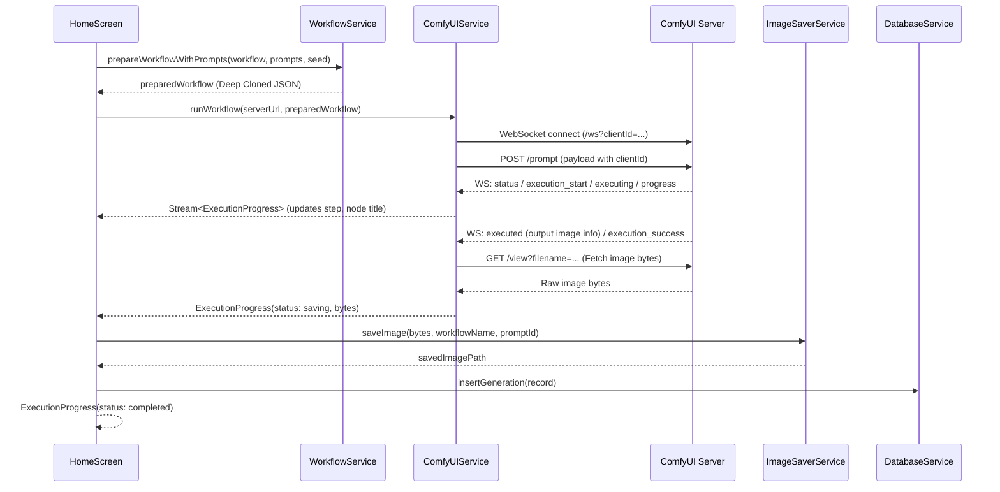

# AGENTS.md — Agent & Developer Guide for ComfyUI Runner

This document provides architecture blueprints, execution flows, conventions, and operational instructions for AI coding agents and human developers maintaining or extending the **ComfyUI Runner** codebase.

---

## 1. Project Overview & Architecture

**ComfyUI Runner** (`comfyui_app`) is a cross-platform Flutter application (Android, iOS, Linux, macOS, Windows, Web) designed to execute, monitor, and manage ComfyUI workflows directly from desktop and mobile devices.

### Architecture
- **Layer-First Structure**: The `lib/` directory is organized by technical concern:
  - `lib/main.dart` - Entry point, theme definitions (Material 3 light/dark)
  - `lib/models/` - Domain models and enums
  - `lib/services/` - Core logic, API, database, and asset handlers
  - `lib/screens/` - Full-page routing destinations
  - `lib/widgets/` - Reusable UI components
- **State Management**: Relies heavily on Flutter's built-in `setState` within `StatefulWidget`s. No external state management libraries (like Provider, Riverpod, Bloc, or Signals) are used.
- **Dependency Injection**: Uses Singleton instances for services, specifically `DatabaseService.instance` and `ComfyUIService.instance`.
- **Data Flow**: Data generally flows from UI (`HomeScreen`) -> Services (`WorkflowService`, `ComfyUIService`) -> ComfyUI Server -> UI -> Local DB (`DatabaseService`).



---

## 2. Environment, Code Generation & Build Commands

- **Flutter/Dart SDK**: Requires Dart SDK `>= 3.13.5`. Ensure standard `flutter` / `dart` commands are used. The project does not use environment version managers like `.fvmrc` or `mise.toml`.
- **Dependencies Management**: Fetch dependencies using:
  ```bash
  flutter pub get
  ```
- **Code Generation**: This project does **not** use code generation tools (no `build_runner`, `freezed`, `json_serializable`, `pigeon`, or `ffigen`). No `dart run build_runner build` commands are necessary.
- **Localization**: No localization setup (`l10n.yaml`, `.arb` files) is present. Do not run `flutter gen-l10n`.
- **Build Commands**:
  - Android APK (debug): `flutter build apk --debug`
  - Linux Desktop: `flutter build linux`
  - Windows Desktop: `flutter build windows`
  - macOS Desktop: `flutter build macos`
  - Web: `flutter build web`

---

## 3. Testing, Static Analysis & Verification Workflow

- **Static Analysis**: The project uses standard `flutter_lints`. To check for errors, warnings, and lints:
  ```bash
  flutter analyze
  ```
- **Formatting**: To format all Dart code and ensure correct styling:
  ```bash
  dart format --output=none --set-exit-if-changed .
  ```
- **Testing**:
  - To run all unit and widget tests:
    ```bash
    flutter test
    ```
  - To target a single test file:
    ```bash
    flutter test test/widget_test.dart
    ```
  - **Headless vs Integration Tests**: Only headless unit/widget tests are present in `test/`, which agents can execute directly. No device-dependent `integration_test/` directory exists.

---

## 4. Dart & Flutter Coding Conventions

- **Widget & UI Layer**:
  - Prefer creating small `StatelessWidget` or `StatefulWidget` classes over using helper methods that return widgets.
  - Utilize `const` constructors wherever possible for widgets and models to optimize rebuilds.
  - **Material 3 / Color Discipline**: Use `Theme.of(context)` for styling (e.g., `Theme.of(context).colorScheme.onSurface`). Do not hardcode colors like `Colors.black` or `Colors.white`.
  - Follow the existing card pattern: `CardThemeData` with 0 elevation and subtle border.
- **State & Concurrency**:
  - Workflows and state maps must be cloned before modification to avoid direct mutation.
  - Check `if (!context.mounted) return;` across `async` gaps before interacting with `context`.
  - Ensure correct stream lifecycle management when listening to streams.
  - Network, WebSocket, and SQLite operations must always be guarded with `try-catch` blocks.
- **Native Interop**: No custom platform channels (`MethodChannel`/`EventChannel`), Pigeon schemas, or Dart FFI bindings are present natively in this repo; it relies on established plugins (e.g., `gal`, `sqflite_common_ffi`). Fall back gracefully when native platform plugins fail and log via `debugPrint`.

---

## 5. Agent Guardrails (Do's and Don'ts)

- **Do** always re-run `flutter analyze` and relevant `flutter test` targets before finalizing and committing changes.
- **Do** use `flutter pub add <package>` or `flutter pub remove <package>` (or follow existing version-pinning conventions in `pubspec.yaml`) when managing packages.
- **Don't** manually edit generated files, although this project currently does not have any generated files (`*.g.dart`, `*.freezed.dart`, `*.gr.dart`, `*.mocks.dart`, or generated `app_localizations*.dart`).
- **Do** ensure ComfyUI workflows added to `workflows/` are exported in **API format** and that prompt nodes are explicitly titled `positive_prompt` and `negative_prompt`.

