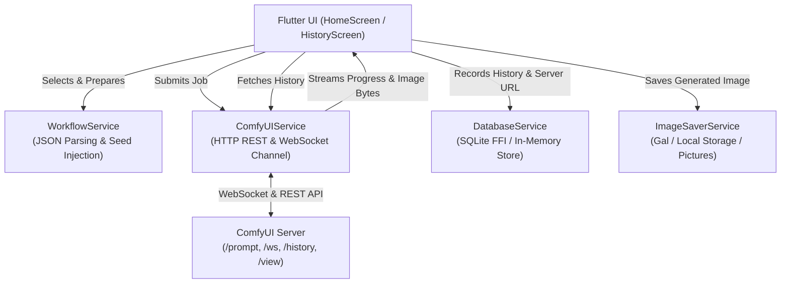

# ComfyUI Runner

A modern, cross-platform Flutter application for interacting with and executing [ComfyUI](https://github.com/comfyanonymous/ComfyUI) workflows directly from mobile (Android, iOS) and desktop (Linux, macOS, Windows).

---

## 🌟 Key Features

- **🔌 Real-Time ComfyUI Connectivity**
  - Connect to local or remote ComfyUI instances over HTTP and WebSocket (`/ws`).
  - Live connection status check via `/system_stats` with ping timestamps.
  - Persistent server configuration with configurable default fallback (`http://192.168.0.198:8188`).

- **🎨 Bundled Workflow Library & Categorization**
  - Includes pre-configured ComfyUI API workflows ready to run out of the box (Flux Dev, SDXL, AnimateDiff, Pony, Animagine, Illustrious).
  - Searchable workflow picker bottom sheet with category filter chips (`Flux`, `SDXL`, `AnimateDiff`, etc.).
  - Automatic prompt extraction from workflow nodes (`CLIPTextEncode`, node titles, inputs `text`, `text_g`, `text_l`).

- **✍️ Intuitive Prompt Editor**
  - Dedicated cards for Positive and Negative prompts with syntax accent styling.
  - Quick actions: Copy to clipboard, Clear text, and Reset to workflow defaults.
  - Automatic seed randomization toggle with node-level injection (`seed`, `noise_seed`, `PrimitiveInt`).

- **⚡ Live Progress & Node Execution Monitoring**
  - WebSocket-powered execution feedback: current step, total steps, percentage progress, and active node title.
  - Ability to cancel in-flight executions.
  - Formatted error messages with collapsible diagnostics.

- **🖼️ Image Preview & Gallery Integration**
  - Instant output preview upon generation completion.
  - Interactive full-screen viewer with pinch-to-zoom (up to 4x).
  - Automatically saves images to:
    - **Android & iOS**: Device photo gallery/album (`ComfyUI`) via [`gal`](https://pub.dev/packages/gal) and app documents storage.
    - **Desktop**: User's `~/Pictures/ComfyUI` folder.

- **📜 Dual History Tracking (Local & Server)**
  - **Local Saved History**: SQLite database storing generation records (workflow, prompts, seed, prompt ID, local file path, timestamp).
  - **Remote Server History**: Browse past runs directly from ComfyUI (`/history`).
    - Filter and search history by Prompt ID, prompt number, or prompt keywords.
    - Lookup specific Prompt ID from clipboard or manual entry.
    - Download individual or all generated images for any server history item to gallery and local database.
    - One-click prompt reload ("Load into Editor") to reuse parameters.

- **🌓 Material 3 Design**
  - Built with Flutter Material 3, including full support for system Light and Dark modes.

---

## 🏗️ Architecture



---

## 📁 Project Structure

```text
comfyui_app/
├── lib/
│   ├── main.dart                      # App entry point & Material 3 theme configuration
│   ├── models/
│   │   ├── comfyui_history_item.dart  # ComfyUI server history & image info models
│   │   ├── execution_state.dart       # Execution progress state machine
│   │   └── generation_record.dart     # SQLite record model for local history
│   ├── screens/
│   │   ├── home_screen.dart           # Primary workspace (connect, pick, prompt, run, view)
│   │   ├── history_screen.dart        # Dual-tab history (Local SQLite & Server History)
│   │   └── server_history_screen.dart # Dedicated remote ComfyUI server history view
│   ├── services/
│   │   ├── comfyui_service.dart       # HTTP client and WebSocket streaming handler
│   │   ├── database_service.dart      # SQLite database with FFI desktop support & fallback
│   │   ├── image_saver_service.dart   # Gallery & file system image exporter
│   │   └── workflow_service.dart      # Asset workflow loader & prompt extractor
│   └── widgets/
│       ├── connection_card.dart       # Server connection card with ping check & editor
│       ├── progress_monitor.dart      # Real-time node and step progress bar
│       ├── prompt_editor.dart         # Positive/Negative prompt inputs & seed switch
│       ├── result_view.dart           # Image output preview with zoom & gallery button
│       ├── server_history_view.dart   # Remote server history browser with search & download
│       └── workflow_picker.dart       # Bottom sheet workflow selector with categories
├── workflows/                         # Bundled ComfyUI workflow files (API JSON format)
└── test/
    ├── history_feature_test.dart      # Unit and widget tests for history parsing & UI
    └── widget_test.dart               # App smoke and widget tests
```

---

## 🚀 Getting Started

### Prerequisites

1. **Flutter SDK** (3.13.5 or later) installed and added to your `PATH`.
2. **Dart SDK** (included with Flutter).
3. **ComfyUI Server** running and accessible over your network.
   - Run ComfyUI with `--listen 0.0.0.0` to allow connections from other devices on the same local network:
     ```bash
     python main.py --listen 0.0.0.0 --port 8188
     ```

### Installation

1. **Clone the repository:**
   ```bash
   git clone https://github.com/kiddos/comfyui_app.git
   cd comfyui_app
   ```

2. **Install Flutter dependencies:**
   ```bash
   flutter pub get
   ```

3. **Run the application:**
   - **Android / iOS Device / Emulator:**
     ```bash
     flutter run
     ```
   - **Linux Desktop:**
     ```bash
     flutter run -d linux
     ```
   - **macOS Desktop:**
     ```bash
     flutter run -d macos
     ```
   - **Windows Desktop:**
     ```bash
     flutter run -d windows
     ```
   - **Web:**
     ```bash
     flutter run -d chrome
     ```

---

## ⚙️ Adding Custom Workflows

To add your own ComfyUI workflow to the app:

1. **Export Workflow as API format in ComfyUI:**
   - In ComfyUI Web UI, open **Settings** (gear icon).
   - Check **Enable Dev mode Options**.
   - Click **Save (API format)** to export a `.json` file.
2. **Name Prompt Nodes (Optional but Recommended):**
   - In ComfyUI, right-click the positive prompt node (`CLIPTextEncode`) and rename title to `positive_prompt`.
   - Right-click the negative prompt node and rename title to `negative_prompt`.
3. **Add to `workflows/` directory:**
   - Place the `.json` file into `workflows/` (e.g., `workflows/my_custom_workflow.json`).
4. **Register in `pubspec.yaml` (already mapped to `workflows/`):**
   ```yaml
   flutter:
     assets:
       - workflows/
   ```
5. Rebuild or restart the app. The new workflow will automatically appear in the Workflow Picker!

---

## 🧪 Running Tests

Run the test suite using:

```bash
flutter test
```

---

## 📱 Permissions

- **Android**: `READ_EXTERNAL_STORAGE` / `WRITE_EXTERNAL_STORAGE` / `READ_MEDIA_IMAGES` (managed by `gal` for gallery export).
- **iOS**: `NSPhotoLibraryAddUsageDescription` and `NSPhotoLibraryUsageDescription` configured in `Info.plist`.

---

## 📄 License

This project is open-source and available under the terms of the [MIT License](LICENSE).
